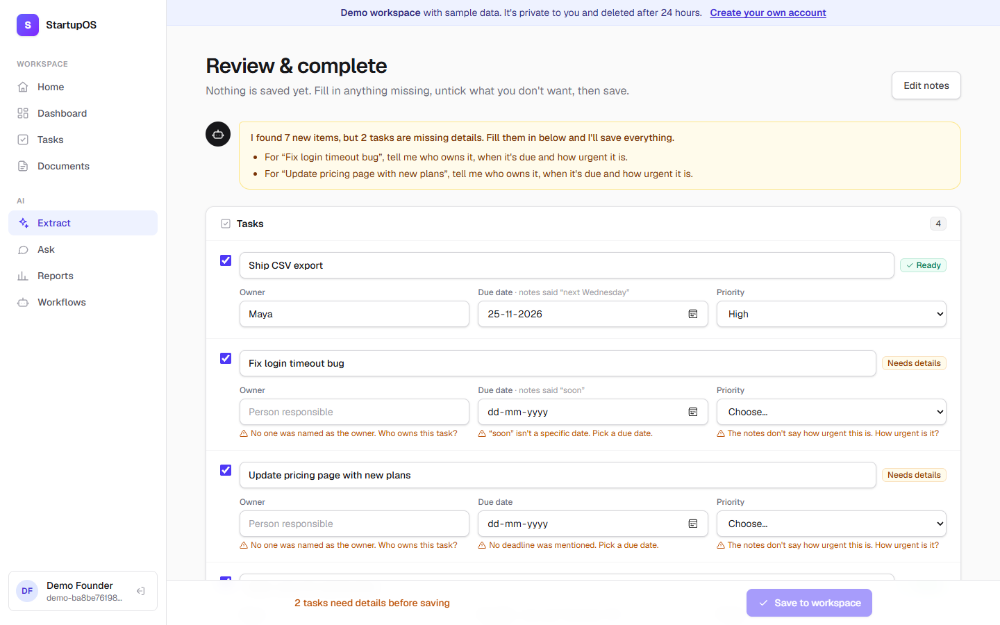
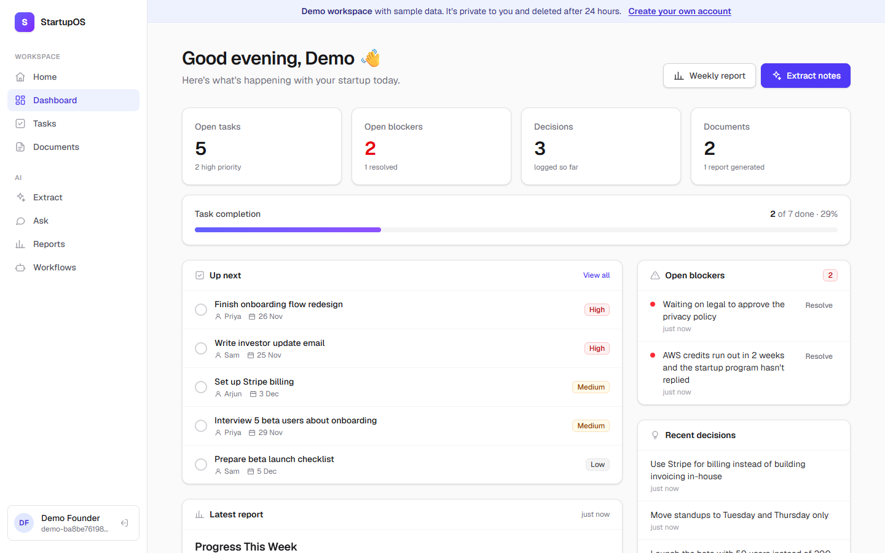
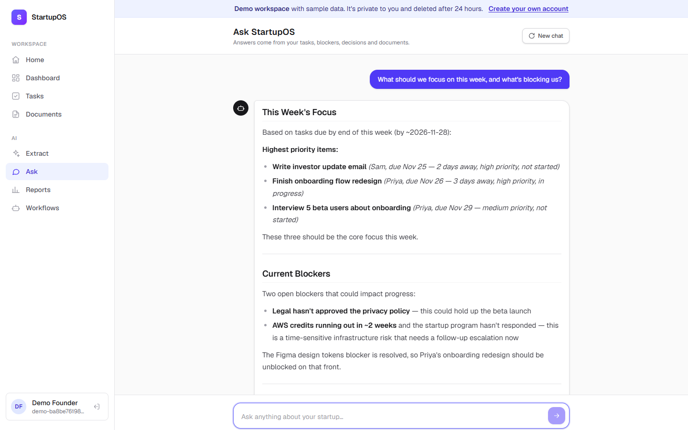
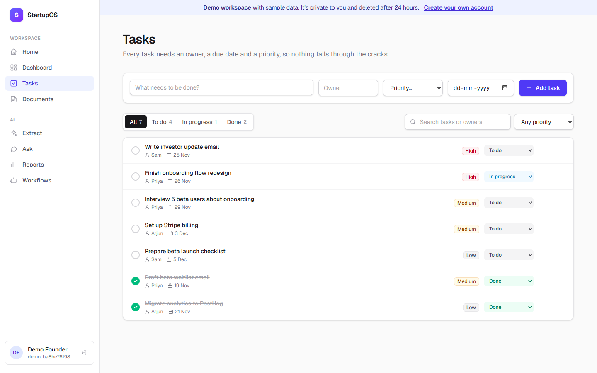
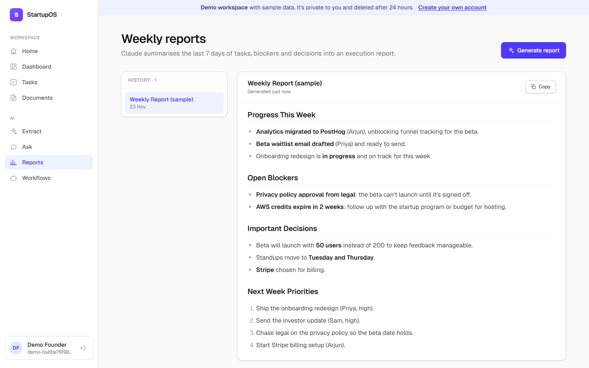
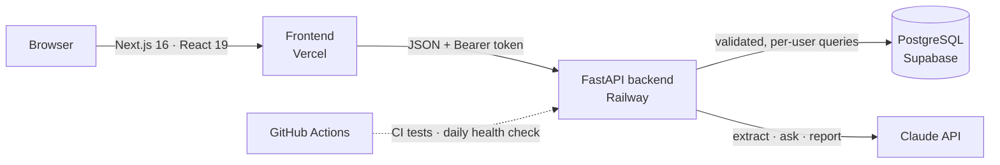

# StartupOS

[](https://github.com/divyananand/StartupOS/actions/workflows/ci.yml)

**Turn messy meeting notes into a clear plan.** StartupOS is an AI workspace for early-stage teams. Paste raw notes from a standup or planning call, and Claude pulls out the tasks, blockers and decisions. Before anything is saved, it asks you for whatever the notes left out: who owns a task, when it's actually due, and how urgent it is.

**[▶ Try the live demo](LIVE_DEMO_URL)** — one click, no sign-up. You get a private workspace with sample data.



## What it does

| | |
|---|---|
| **Extract** | Paste meeting notes → Claude drafts tasks, blockers and decisions → you fill any gaps → save. Relative dates like "next Wednesday" become real dates; vague ones like "soon" are flagged. |
| **Ask** | Chat with your company data: *"What should we focus on this week, and what's blocking us?"* Answers use only your own tasks, blockers, decisions and documents. |
| **Weekly report** | One click turns the last 7 days of activity into progress, open blockers, key decisions and next week's priorities. |
| **Dashboard & tasks** | Progress at a glance, inline status changes, filters, and a "Needs details" view for anything incomplete. |

<table>
  <tr>
    <td></td>
    <td></td>
  </tr>
  <tr>
    <td></td>
    <td></td>
  </tr>
</table>

## Engineering highlights

- **The AI never saves half-finished records.** LLM extraction is treated as a *draft*. A validation layer (`backend/validation.py`) checks every item: tasks need a named person (not "we" or "the team"), a real calendar date that isn't in the past, and a priority the notes actually stated. The UI turns each gap into a follow-up question, and the API enforces the same rules again on save.
- **No duplicates.** Re-extracting the same notes flags items already in your workspace and unticks them.
- **Per-user data isolation.** Accounts use bcrypt-hashed passwords and JWT sessions. Every query is scoped to the signed-in user, and tests check that one user can't read, edit or delete another's data.
- **Safe to leave public.** AI requests are metered per user per day, demo accounts get lower limits, and there's a global daily cap on spend. Logins are rate limited. Failed AI calls are refunded, so errors don't use up anyone's quota.
- **Instant demo.** "Try the demo" creates a throwaway account seeded with realistic data, isolated from every other visitor and deleted after 24 hours.
- **Fast against a remote database.** A small custom connection pool keeps connections open and creates them in parallel. Psycopg2's built-in pool closed idle connections and reopened them one at a time, so the dashboard's parallel requests went from ~20s to ~2s.
- **Tested.** 32 backend tests run against a real Postgres (in an isolated schema) with Claude stubbed out, plus type-checking, linting and a production build in CI.

## Architecture



| Layer | Tech |
|---|---|
| Frontend | Next.js 16, React 19, TypeScript, Tailwind CSS v4 |
| Backend | Python, FastAPI, Pydantic, psycopg2 |
| Auth | bcrypt, JWT (PyJWT) |
| Database | PostgreSQL (Supabase) |
| AI | Claude API (Anthropic Python SDK) |
| Infra | Vercel, Railway, GitHub Actions |

## Run it locally

**Backend** (Python 3.12+)

```bash
cd backend
python -m venv venv
venv\Scripts\activate          # macOS/Linux: source venv/bin/activate
pip install -r requirements.txt
uvicorn main:app --reload
```

Create `backend/.env`:

```
ANTHROPIC_KEY=your-anthropic-key
DATABASE_URL=postgresql://...        # any Postgres, e.g. a free Supabase project
JWT_SECRET=a-long-random-string      # python -c "import secrets; print(secrets.token_urlsafe(48))"
```

Tables are created automatically on startup. See [backend/README.md](backend/README.md) for every setting and the full API.

**Frontend** (Node 20+)

```bash
cd startupos
npm install
npm run dev
```

Create `startupos/.env.local`:

```
NEXT_PUBLIC_API_URL=http://127.0.0.1:8000
```

Open http://localhost:3000.

**Tests**

```bash
cd backend
pip install -r requirements-dev.txt
pytest
```

Tests use the database in `DATABASE_URL`, but only inside a temporary `startupos_pytest` schema that is dropped afterwards. Claude is stubbed, so they cost nothing.

## Project structure

```
backend/
  main.py          API routes: tasks, documents, extract, ask, reports
  auth.py          sign-up, login, JWT sessions, demo accounts
  validation.py    what counts as a complete task / blocker / decision
  limits.py        AI usage limits and login rate limiting
  db.py            connection pool and schema migrations
  demo.py          sample data for demo workspaces
  tests/           pytest suite
startupos/
  app/             pages (dashboard, tasks, extract, ask, report, login…)
  components/      UI kit, sidebar, app shell, auth form
  lib/             API client, auth context, validation rules
.github/workflows/ CI and daily health check
```

---

Built by [@divyananand](https://github.com/divyananand) as a learning project: going from zero to full-stack AI engineering.
